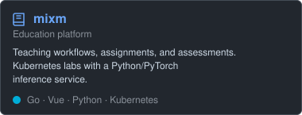
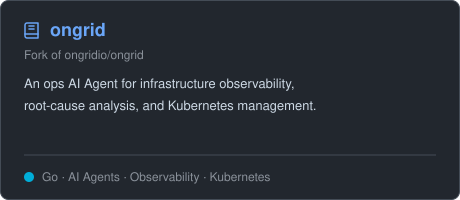

# 👋 Hey there, I'm Dragonzz!

📍 Shanghai · East China University of Science and Technology

I build backend services and education tools with Go and Python, connecting web applications with Kubernetes infrastructure and machine learning services.

🔭 Building [mixm](https://github.com/Dragonzz27/mixm), an education platform with teaching workflows, assessment tools, and Kubernetes-powered lab environments.

🌱 Exploring cloud-native infrastructure, observability, and AI-assisted operations through projects such as [ongrid](https://github.com/Dragonzz27/ongrid).

## 🔧 Technologies & Tools

**Programming Languages:**

**Frameworks and Libraries:**

**Databases and Messaging:**

**Tools and Services:**

## 🗂️ Highlight Projects

  
  

